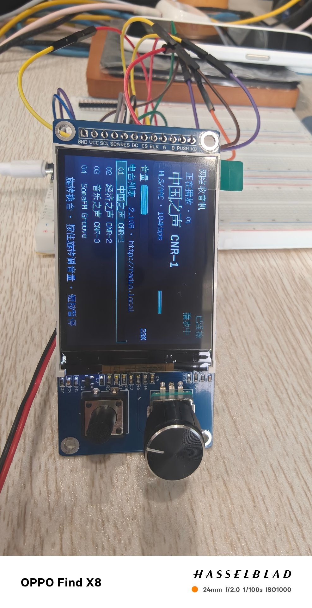

# 📻 NetworkRadio — ESP32-S3 网络收音机

> 一台带彩色屏幕、旋钮和网页控制台的开源网络收音机。
> ESP32-S3 + MAX98357A + 2.4" ST7789 彩屏 + EC11 旋钮，支持 HLS / MP3 / AAC 流媒体播放，
> 断流自愈、多 WiFi 记忆、手机配网、电台库管理（最多 200 个自定义电台）。

**当前版本 v0.7.5** | 固件占用 3MB Flash 的 95% | 详见 [硬件与接线](docs/HARDWARE.md) · [功能与使用](docs/USAGE.md) · [架构说明](ARCHITECTURE.md)



*▲ 实机运行照：正在播放"中国之声 CNR-1"（HLS 流），屏幕显示播放卡片 / 音量条 / 电台列表 / 走马灯控制台提示*

---

## ✨ 功能总览

### 🎵 播放
- 支持 **HLS (m3u8) / MP3 / AAC** 网络流（基于 [ESP32-audioI2S 3.4.7](https://github.com/schreibfaul1/ESP32-audioI2S)）
- 内置 6 个电台（央广三套 / SomaFM / Radio Paradise），自定义电台上限 **200 个**
- 音量 0–21 级、静音、暂停，掉电记忆（音量 + 上次电台，重启自动续播）

### 🖥️ 2.4" 彩屏 UI（320×240，ST7789）
- **主页**：正在播放卡片（台名大字 + 播放状态 + 码率 + 音量电平条）、音量条、电台列表（自动滚动跟随）
- **信息页**：固件版本 / 复位原因 / WiFi 信号 / 运行时长 / 内存 / 自愈统计 / 控制台地址，旋钮滚动查看
- **配网指导页**：进配网模式自动显示热点名 + 配置页 IP，照着连就行
- **控制台走马灯**：主页常驻滚动提示 `控制台 http://<IP> · http://radio.local`
- **无操作自动熄屏**（默认 10 秒，可调 0–3600 秒，掉电记忆），任意操作点亮
- 布局**按分辨率自适应**，支持换驱动（ST7789 / ILI9341 / ST7796 只改一行配置）

### 🎛️ 旋钮与按键
| 操作 | 功能 |
|---|---|
| 旋转 EC11 | 选台（列表高亮跟随，停手 0.25s 自动播放） |
| 按住旋钮 + 旋转 | 调音量 |
| 长按旋钮 1 秒 | 锁定 / 退出音量模式 |
| 旋钮短按 | 暂停 / 继续 |
| K0 短按 | 静音切换 |
| K0 长按 1 秒 | 主页 / 信息页切换 |
| BOOT 短按 | 下一台 |
| BOOT 长按 5 秒 | 进入 / 退出配网模式 |

### 🌐 网页控制台
联网后手机/电脑浏览器访问 `http://radio.local`（mDNS，无需背 IP）或设备 IP：
- 播放 / 暂停 / 音量 / 换台
- 电台增删改、**批量导入导出 JSON**、分页搜索
- 诊断：`/api/status`、`/api/diag`、`/api/events`（最近事件日志）

### 📱 手机配网
- 无 WiFi 记忆时自动开启 AP 热点（`Radio-XXXX`），captive portal 自动弹出配置页
- 最多记忆 **5 组 WiFi**，掉线自动重连、连续失败自动轮换下一个网络

### 🩹 断流自愈（本项目最下功夫的部分）
- **解码时钟看门狗**：以"解码器真的解出 PCM"为唯一可靠判据（6 秒不前进即判僵死）
- 指数退避重连：4 / 8 / 16 / 30 / 60 秒
- **死地址判定**：连续 4 次完全解不出音频（403/404/下线）→ 自动跳下一台
- 极端情况自发重启 + **重启风暴保护**（连续自发重启超限后禁用，改走跳台路线）
- 事件全部记录到 `/api/events`，故障可追溯

### 💾 存储架构
| 存储 | 用途 |
|---|---|
| NVS (Preferences) | WiFi 凭据（≤5 组）、音量、上次电台等小键值 |
| LittleFS (896KB) | `/stations.json` 电台库（≤200 个，支持导入导出） |

---

## 🔧 硬件清单

| 模块 | 型号/规格 | 备注 |
|---|---|---|
| 主控 | ESP32-S3 开发板 | 4MB Flash，PSRAM 建议 OPI |
| 功放 | MAX98357A (I2S) | 3W Class-D，直推 4Ω/8Ω 喇叭 |
| 屏幕 | 2.4" ST7789 240×320 SPI | 支持换 ILI9341 / ST7796 |
| 旋钮 | EC11 编码器（带按压） | |
| 按键 | 独立按键 K0 ×1 | |

完整接线表、避坑指南（⚠️ **屏幕 VCC 必须接 5V**、MAX98357A SD 脚必须拉高等）见 **[docs/HARDWARE.md](docs/HARDWARE.md)**。

## 🚀 快速开始

1. 按接线表连接硬件（先只接功放也能跑）
2. 用 Arduino IDE 打开 `NetworkRadio.ino`，按 [HARDWARE.md](docs/HARDWARE.md#️-ide-编译选项) 设置工具菜单选项
3. 编译烧录，打开串口监视器（115200），按提示配网
4. 浏览器打开 `http://radio.local` 管理电台

## 📁 项目结构

```
NetworkRadio/
├── NetworkRadio.ino        # 入口：初始化编排 + 主循环 + 串口命令台
├── ARCHITECTURE.md         # 代码分层与模块职责说明
├── docs/
│   ├── HARDWARE.md         # 硬件清单、接线表、避坑指南
│   └── USAGE.md            # 功能与使用手册（屏幕/旋钮/网页/串口）
└── src/
    ├── core/               # AppConfig.h 全局配置（引脚/常量/存储规范）
    ├── net/                # WiFi 多网络记忆、AP 配网门户
    ├── audio/              # 播放引擎、断流自愈、电台库、硬件自检音
    └── hmi/                # 彩屏 UI、旋钮、按键、网页控制台、串口台
```

分层依赖单向：`hmi → audio → net → core`，详见 [ARCHITECTURE.md](ARCHITECTURE.md)。

## ⚙️ 主要可调配置（`src/core/AppConfig.h`）

| 配置 | 默认值 | 说明 |
|---|---|---|
| `PIN_I2S_*` | 16/17/18 | 功放 BCLK/LRC/DIN |
| `PIN_TFT_*` | 47/21/42/41/40/9 | 屏幕 SCLK/MOSI/CS/DC/RST/BLK |
| `PIN_ENC_A/B/PUSH` | 5/4/6 | EC11 旋钮 |
| `PIN_KEY_K0` | 7 | 独立按键 |
| `TFT_DRIVER` | 0 (ST7789) | 1=ILI9341, 2=ST7796(320×480) |
| `TFT_BRIGHT_DEFAULT` | 165 | 开机背光 0–255 |
| `MAX_CUSTOM_STATIONS` | 200 | 自定义电台上限 |
| `WIFI_MAX_SAVED` | 5 | 记忆的 WiFi 组数 |

## 📜 开源许可

仅供学习交流使用。流媒体内容版权归各自电台所有。
